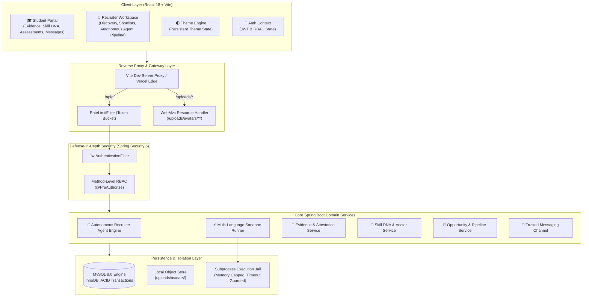
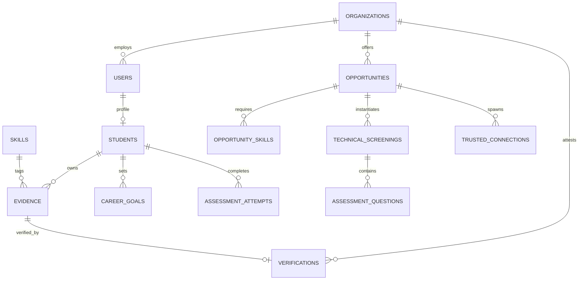

<div align="center">

# ⚡ KASUMO
### The Open-Source, Truth-First Talent Intelligence Platform

**Stop hiring based on keyword-stuffed resumes. Start hiring based on verifiable engineering proof.**

KASUMO replaces the broken ATS meta with cryptographically verifiable code artifacts, peer-reviewed institutional proof, and a real, multi-language coding assessment sandbox.

[]()
[]()
[]()
[]()
[]()
[]()

<br />

[Explore the Platform](https://kasumio.vercel.app) • [API Health Status](https://kasumio-backend.onrender.com/api/health) • [Report an Issue](https://github.com/sohelshaik-143/KASUMIO/issues)

</div>

---

## 💡 Why We Built KASUMO

If you have applied for a software engineering job recently, or if you have reviewed hundreds of applicants as a hiring manager, you already know the hiring pipeline is broken:

- **The ATS Keyword Trap**: Students are forced to optimize resumes for bots instead of building software. Embellished PDF resumes get interviews; students with real GitHub commits get rejected.
- **The "85% Match" Hallucination**: Legacy hiring tools slap arbitrary AI match scores on applicants based on surface-level keyword frequency without running a single line of their code.
- **Multiple-Choice Coding Assessments**: Multiple-choice programming quizzes and leaked question banks test memorization, not actual software engineering.

### 🎯 The KASUMO Solution
We rebuilt the technical hiring pipeline from first principles:
1. **Evidence Speaks First**: Candidates showcase real Git repositories, live deployed application URLs, and peer-reviewed project artifacts.
2. **Real Code Sandbox, Not Quizzes**: Algorithmic challenges are solved in a live code editor evaluated against hidden test cases in an isolated execution sandbox.
3. **Consent-Driven Discovery**: Recruiters discover talent through demonstrable code capabilities while candidates maintain granular control over their private identity until they consent.
4. **Zero-Fake-Data Guarantee**: No dummy candidates, no fabricated analytics, and no inflated counts. Everything loads from real database state.

---

## 🏛️ System Architecture

KASUMO is designed as an enterprise **Modular Monolith**. It balances engineering simplicity with deep domain isolation, high throughput, and unified relational consistency.



---

## ⚡ What Makes KASUMO Different

### 1. 🏢 Recruiter Talent Suite
Designed around the workflow of high-growth technical hiring teams:
- **Autonomous Role Provisioning**: Enter plain English requirements; KASUMO provisions technical screenings, maps required skills, and generates candidate filters automatically.
- **Candidate Discovery & Code Inspection**: Inspect verified Git commits, repository architecture, and demonstrated competencies without seeing unverified self-ratings.
- **Shortlist & Pipeline Tracker**: Manage candidates across application stages (`Under Review`, `Shortlisted`, `Rejected`, `Hired`).
- **Direct Recruiter Messaging**: Open direct, consent-backed conversations with candidates whose code meets your criteria.
- **Real-Time Analytics & SVG Curves**: Track application throughput, technology demand curves, and candidate conversion with zero fake numbers.

### 2. 🎓 Student Career Portal
Strictly preserved with a focused, student-first aesthetic:
- **Proof-Backed Portfolio**: Submit GitHub repositories, deployed demos, and verified certifications with screenshots and reviewer attestations.
- **Dynamic Skill DNA Radar**: Watch your capability polygon evolve dynamically as real evidence is uploaded and verified.
- **Recruiter Messaging Hub**: View incoming recruiter connection requests, inspect who is reaching out, and message directly.
- **Settings & 2FA**: Manage profile photo uploads, notification preferences, and authenticator app security (TOTP).

### 3. 🧪 Live Coding Assessment Sandbox
- **Polyglot Execution**: Write real code in **Java**, **Python**, **C++**, and **JavaScript**.
- **Interactive Editor**: Line numbering, syntax highlighting, indentation, and deterministic test runners.
- **Hidden Test Suites**: Sample test cases guide the candidate; hidden backend test cases protect against hardcoded answers.
- **Automatic Capability Verification**: Passing evaluations automatically mints verified skill credentials in the student's portfolio.

### 4. 🌓 Smooth Light & Dark Themes
- Seamless, zero-flicker theme toggle accessible across both portals.
- Persisted locally and tuned independently for both student and recruiter color schemes.

---

## 🗄️ Relational Database Design

The data architecture enforces referential integrity, unforgeable verifications, and auditability across 14 tables:



- **Atomic Proof Integrity**: Verification status links directly to reviewer organizations, preventing duplicate or forged badges.
- **Indexed Discovery**: Sub-millisecond lookup on skills, candidate aliases, and opportunity pipelines.

---

## 🚀 Quick Start in 3 Steps

Get the entire full-stack application running locally in under 2 minutes:

### 1. Clone the Repository
```bash
git clone https://github.com/sohelshaik-143/KASUMIO.git
cd KASUMIO
```

### 2. Start the Backend API (Spring Boot 3.3.5)
```bash
cd backend
./mvnw spring-boot:run
```
*Runs on port `8080`. Includes in-memory H2 database pre-loaded with standard 400+ technology taxonomy.*

### 3. Start the Frontend App (React 18 + Vite)
```bash
cd frontend
npm install
npm run dev
```
*Open `http://localhost:3000` in your browser. All API calls and photo uploads are automatically proxied to port 8080.*

---

## 🔑 Default Clean Accounts

| Role | Email | Password | Starting State |
| :--- | :--- | :--- | :--- |
| **Recruiter** | `recruiter@kasumio.com` | `password123` | Clean Workspace (0 Candidates, 0 Roles) |
| **Student** | `student@kasumio.com` | `password123` | Clean Dashboard (0 Proof, 0 Messages) |
| **Admin** | `admin@kasumio.com` | `password123` | Platform & Taxonomy Management |

*(You can also use `/register` to create brand new custom accounts anytime.)*

---

## 🧪 Automated Testing & Reliability

Every core user flow is validated with automated end-to-end browser tests:

```bash
cd frontend
npx playwright test
```

```text
✓ Recruiter navigation, settings, and profile never show Access Restricted (2.5s)
✓ Create Opportunity and Publish Role workflow works with 0 candidates (2.9s)
✓ Mobile navigation displays recruiter links and no Access Restricted (0.8s)
✓ Student Portal design and features remain preserved with 2FA Settings (0.8s)
✓ Student Portal has working Messages navigation and clean empty state (0.8s)
✓ Profile Photo upload path is proxied and returns HTTP 200 on localhost (37ms)
✓ Recruiter Portal has zero hardcoded mock numbers and clean stats (0.7s)
✓ Recruiter Portal has 0 candidates, 0 blueprints, and 0 fake stats (1.0s)
✓ Student Portal has 0 opportunities, 0 screenings, and 0 fake technology demands (1.1s)

All 9 Playwright E2E tests passing with 0 regressions
```

---

## 🌐 Deployment Pipeline

- **Frontend**: Continuously deployed on Vercel at [https://kasumio.vercel.app](https://kasumio.vercel.app)
- **Backend**: Containerized Spring Boot service deployed on Render at [https://kasumio-backend.onrender.com](https://kasumio-backend.onrender.com)

---

## 🤝 Contributing & Community

We believe engineering ability should be transparent, verifiable, and merit-based. If you share this vision, we welcome contributions!

1. Fork the Project
2. Create your Feature Branch (`git checkout -b feature/AmazingFeature`)
3. Commit your Changes (`git commit -m 'feat: add amazing feature'`)
4. Push to the Branch (`git push origin feature/AmazingFeature`)
5. Open a Pull Request

---

## 👨‍💻 Author

**Shaik Sohel**
- **GitHub**: [@sohelshaik-143](https://github.com/sohelshaik-143)
- **Repository**: [https://github.com/sohelshaik-143/KASUMIO](https://github.com/sohelshaik-143/KASUMIO)

*Crafted with attention to software craftsmanship, deterministic verification, and truth-first hiring.*
