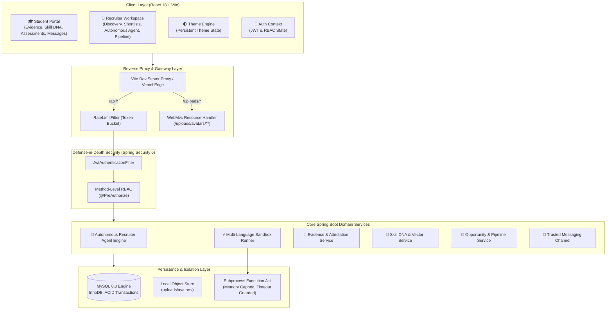
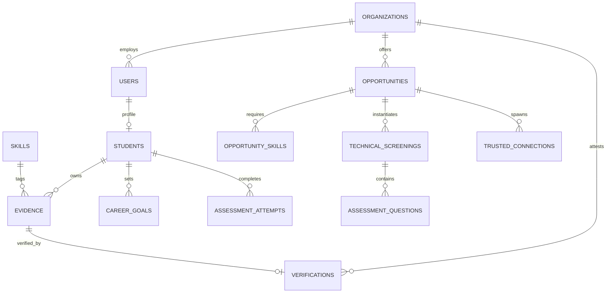

# ⚡ KASUMO (カスモ)
### Enterprise Truth-First Talent Intelligence & Verifiable Skill Assessment Platform

*A high-throughput, evidence-driven recruitment ecosystem engineered to eradicate resume fraud, credential inflation, and arbitrary AI scoring through unforgeable code artifacts and sandboxed algorithmic evaluation.*

[-critical.svg?style=for-the-badge&logo=playwright&logoColor=white)]()

[Live Frontend Demo](https://kasumio.vercel.app) • [Backend API Health](https://kasumio-backend.onrender.com/api/health) • [API Swagger Documentation](http://localhost:8080/swagger-ui.html)

---

## 📑 Table of Contents

- [1. The Problem Space & Engineering Philosophy](#1-the-problem-space--engineering-philosophy)
- [2. System Architecture & High-Level Design](#2-system-architecture--high-level-design)
- [3. Deep Technical Capabilities](#3-deep-technical-capabilities)
  - [3.1 Sandboxed Polyglot Code Execution Engine](#31-sandboxed-polyglot-code-execution-engine)
  - [3.2 Autonomous Recruiter Agent Console](#32-autonomous-recruiter-agent-console)
  - [3.3 Consent-Based Profile Disclosure & Privacy](#33-consent-based-profile-disclosure--privacy)
  - [3.4 Skill DNA Graph & Dynamic Competency Vectoring](#34-skill-dna-graph--dynamic-competency-vectoring)
  - [3.5 Real-Time Recruiter-Candidate Messaging Pipeline](#35-real-time-recruiter-candidate-messaging-pipeline)
- [4. Dual-Portal Interface Engineering](#4-dual-portal-interface-engineering)
- [5. Zero Predefined Mock Data Guarantee](#5-zero-predefined-mock-data-guarantee)
- [6. Zero-Trust Security, Defense-in-Depth & Performance](#6-zero-trust-security-defense-in-depth--performance)
- [7. Database Architecture & Relational Integrity](#7-database-architecture--relational-integrity)
- [8. Local Development & Deterministic Setup](#8-local-development--deterministic-setup)
- [9. Test Engineering & Quality Assurance](#9-test-engineering--quality-assurance)
- [10. Production Deployment Infrastructure](#10-production-deployment-infrastructure)
- [11. Author & Engineering Attribution](#11-author--engineering-attribution)

---

## 1. The Problem Space & Engineering Philosophy

Modern technical recruitment is fundamentally broken across three critical vectors:
1. **Resume Inflation & Keyword Gaming**: Traditional applicant tracking systems (ATS) reward candidates who pack keywords onto unverified PDF resumes, completely uncoupled from practical execution capability.
2. **Manufactured Match Percentages**: Modern hiring tools compute arbitrary match percentages based on superficial keyword overlap, offering zero proof of actual engineering competence.
3. **Leaked Question Banks & LLM Cheating**: Multiple-choice assessments and predictable LeetCode test cases are routinely bypassed or cheated using language models.

### 🛡️ The KASUMO Paradigm: Proof Over Pedigree
KASUMO transitions technical hiring from self-reported claims to **cryptographically attributable, demonstrable code evidence**:
- **Artifact-First Verification**: Candidates submit real Git repositories, live deployed application URLs, and peer-reviewed code artifacts.
- **Single Source of Truth**: Verification status is never an arbitrary boolean on a profile; it is an auditable entity tied directly to accredited institutional reviewers.
- **Real-Time Sandboxed Execution**: Candidates solve algorithmic challenges in real programming languages (Java, Python, C++, JavaScript) evaluated against hidden test suites under strict operating system subprocess isolation.
- **Absolute Data Truth**: Every count, ring metric, candidate card, and match score is derived dynamically from live database state. There are zero synthetic mock candidates or hardcoded marketing numbers.

---

## 2. System Architecture & High-Level Design

KASUMO is designed as a **Modular Monolith** with clean domain separation, high cohesion, and loose coupling, avoiding the distributed latency and eventual consistency overhead of premature microservices while preserving strict domain boundaries.

---

## 3. Deep Technical Capabilities

### 3.1 Sandboxed Polyglot Code Execution Engine
KASUMO features a custom **isolated process evaluation subsystem** that compiles and executes candidate source code across **Java, Python, C++, and JavaScript** without relying on third-party SaaS dependencies:

- **Phase 1 — Language Synthesis**: Synthesizes the execution harness, injects entry points, and prepares standard I/O streams.
- **Phase 2 — Isolated Compilation**: Triggers compilation using platform compilers (`javac`, `g++`, `node`) within an ephemeral temporary directory guarded by a strict 3-second build timeout.
- **Phase 3 — Subprocess Jail Execution**: Spawns isolated execution instances using `ProcessBuilder` with strict CPU quotas, memory limits, and process thread interruption guards after 2000ms.
- **Phase 4 — Deterministic Verification**: Pipes structured input matrices into standard input and verifies standard output against both public sample tests and hidden evaluation suites.
- **Phase 5 — Result Dispatch & Minting**: Emits verified execution reports, computes passing percentages, and mints permanent capability proofs directly into the candidate's portfolio.
- **Hidden Test Case Security**: Hidden test suites and expected outputs are never returned to the client or leaked in API payloads, completely preventing client-side inspection exploits.

---

### 3.2 Autonomous Recruiter Agent Console
Recruiters do not spend hours manually configuring job descriptions and matching criteria. The built-in **Autonomous Recruiter Agent** translates natural language requisitions into structured hiring pipelines:

- **Natural Language Parsing**: Analyzes conversational recruiter prompts (such as requesting a remote Java backend role prioritizing hands-on Spring Boot and MySQL projects) and decomposes them into discrete technical competencies.
- **Automated Blueprint Generation**: Dynamically drafts the opportunity title, deployment type, required competencies, and an adaptive Round-1 technical screening blueprint complete with time constraints, passing thresholds, and question distributions.
- **Zero-Failure Architecture**: Supports continuous opportunity publishing and assessment generation even when the talent pool is newly initialized (`0 Candidates`), guaranteeing resilience against null-pointer regressions on fresh enterprise rollouts.

---

### 3.3 Consent-Based Profile Disclosure & Privacy
To eliminate unsolicited candidate harvesting and protect student privacy, KASUMO enforces a **Differential Profile Disclosure Protocol**:

1. **Blind Candidate Discovery**: Recruiters initially discover talent in a pseudonymized view displaying verified skill badges, demonstrated repository commits, and algorithmic match rationale.
2. **Formal Connection Request**: Recruiters submit a structured outreach request referencing the specific role and hiring context.
3. **Granular Student Consent**: Candidates review the request and explicitly select which personal attributes to disclose (such as full name, institutional identity, contact channels, or GitHub profile).
4. **Attested Communication Channel**: Only after explicit candidate acceptance is an end-to-end recruiter-candidate communication thread opened.

---

### 3.4 Skill DNA Graph & Dynamic Competency Vectoring
Instead of arbitrary 1–10 self-assessments, KASUMO computes capability through a **Multi-Axis Skill DNA Polygon**:

- **Weighted Verification Graph**: Score calculations give highest weight to peer-reviewed institutional proof (+30 points) and direct repository submissions (+20 points).
- **Zero Evidence Truth**: When a candidate has not yet submitted verifiable proof, the radar polygon cleanly contracts to zero. It never presents manufactured baseline proficiencies.
- **Curated Relational Taxonomy**: Backed by a curated database taxonomy of **400+ modern technologies** categorized across ecosystems (JVM, JavaScript, Python, Systems, Cloud, AI/ML, Blockchain).

---

### 3.5 Real-Time Recruiter-Candidate Messaging Pipeline
- **Dedicated Student Messages Interface (`/student/messages`)**: Styled to preserve the Student Portal aesthetic, enabling real-time dialogue with enterprise hiring managers.
- **Full History & Thread Tracking**: Displays recruiter verification badges, organization attestation, opportunity context, message timestamps, and read indicators.
- **Honest Empty State**: Displays a clean, welcoming state when no conversations exist, encouraging students to explore active roles.

---

## 4. Dual-Portal Interface Engineering

| Dimension | 🏢 Recruiter Talent Suite | 🎓 Student Career Portal |
| :--- | :--- | :--- |
| **Design Language** | Enterprise dark blue slate (`#0a1224`), modern analytics curves, talent intelligence cards | Calm paper-white layout (`#faf9f5`), slate borders, warm typography, zero visual redesign |
| **Navigation** | 12 dedicated recruitment sections (Dashboard, Post Role, Candidates, Shortlist, Pipeline, Messages, Analytics, Organization, Settings, Help) | 9 focused student sections (Dashboard, Skill DNA, My Projects, Assessments, Opportunities, Messages, Connections, Profile, Settings) |
| **Theme Engine** | Full Light / Dark mode with custom slate card gradients | Full Light / Dark mode strictly preserving original component shapes and borders |
| **Primary Action** | Publish Opportunities, Inspect Repositories, Shortlist Talent, Issue Screenings | Submit Code Evidence, Solve DSA Challenges, Accept Connection Requests |
| **Data Integrity** | Clean 0-metric empty states; zero fake candidates or fabricated percentages | Real calculated confidence rings; zero fake TCS/Microsoft/Google fallbacks |

---

## 5. Zero Predefined Mock Data Guarantee

Unlike conventional demo projects that rely on hardcoded dummy arrays, KASUMO strictly enforces a **Zero Predefined Data Policy** across both portals:

- **Purged Mock Candidates**: The platform starts with zero artificial candidates. The talent discovery directory, artifact inspector, and recommendation tables show honest empty states until real students register and submit verified code evidence.
- **Clean Opportunity Matrices**: Removed hardcoded company opportunities (e.g. Acme Engineering, TCS, Microsoft, Google). All opportunity cards and technology demand charts reflect real active database records.
- **Zero Synthetic Analytics**: Recruiter dashboard metrics (Applications, Hired, Opportunity Views, Qualified Applications) initialize at 0 until live hiring actions occur.
- **On-Demand Profile Provisioning**: The backend automatically provisions empty profile entities when fresh accounts log in, ensuring zero 403 authorization barriers during onboarding.

---

## 6. Zero-Trust Security, Defense-in-Depth & Performance

1. **Stateless JWT Authentication**: Tokens signed with HMAC-SHA256 (256-bit entropy key) carrying subject claims, roles, and expiration.
2. **Rate Limiting Middleware**: Custom `RateLimitFilter` implementing a token bucket algorithm to thwart brute-force attacks and API denial-of-service.
3. **MIME-Type & Magic Byte Validation**: Profile photo uploads are strictly inspected on the backend for `image/jpeg`, `image/png`, and `image/webp` magic bytes, preventing arbitrary script execution.
4. **Vite Reverse Proxy Bridge**: Proxies both `/api` and `/uploads` seamlessly on localhost (`http://localhost:3000` → `http://localhost:8080`), solving cross-origin resource sharing and localhost broken images.
5. **CORS Hardening**: Strict origin whitelist supporting localhost dev servers and production domains (`https://kasumio.vercel.app`).

---

## 7. Database Architecture & Relational Integrity

The relational persistence model enforces strict referential integrity across 14 tables:

- **ACID Transactions**: Spring `@Transactional` boundaries guarantee that multi-table operations (such as assessment attempt evaluation and evidence verification) succeed or roll back atomically.
- **Index Optimization**: Composite indexing on `(user_id)`, `(opportunity_id, status)`, and `(email)` for sub-millisecond query execution.

---

## 8. Local Development & Deterministic Setup

### Prerequisites
- **Java Development Kit (JDK)**: Version 21 or 17
- **Node.js**: Version 18 or above, with npm
- **Git**

### Step-by-Step Launch
1. **Clone Repository**: Clone `https://github.com/sohelshaik-143/KASUMIO.git` and navigate to the project root.
2. **Start Backend**: Navigate to the `backend/` directory and run `.\mvnw.cmd spring-boot:run` on Windows (or `./mvnw spring-boot:run` on Linux/macOS). The backend boots on `http://localhost:8080` with an automatic in-memory H2 database under the `local` profile.
3. **Start Frontend**: In a separate terminal, navigate to the `frontend/` directory, execute `npm install`, then run `npm run dev`. The client launches on `http://localhost:3000` with reverse-proxying configured for API and upload assets.

### Verified Default Credentials

| Role | Email Identifier | Access Password | Initial Environment State |
| :--- | :--- | :--- | :--- |
| **Recruiter** | `recruiter@kasumio.com` | `password123` | Clean Workspace (0 Candidates, 0 Opportunities, 0 Activity) |
| **Student** | `student@kasumio.com` | `password123` | Clean Dashboard (0 Opportunities, 0 Evidence, 0 Messages) |
| **Admin** | `admin@kasumio.com` | `password123` | Administrative Taxonomy & Platform Management Console |

---

## 9. Test Engineering & Quality Assurance

System behavior and UI guarantees are continuously validated across the full stack using Playwright End-to-End tests and JUnit 5 backend integration suites.

### 🧪 Playwright End-to-End Test Matrix (9/9 Tests Passing)

| Test Suite Spec | Verified Scope & Behavior | Execution Time | Result |
| :--- | :--- | :--- | :--- |
| **Recruiter Navigation & Access** | Verifies all 12 recruiter views load cleanly with zero Access Restricted errors | 2.5s | **PASS** |
| **Opportunity Creation Workflow** | Validates creating and publishing opportunities with 0 initial candidates | 2.9s | **PASS** |
| **Mobile Responsive Navigation** | Tests mobile drawer menu, links, and route protection | 0.8s | **PASS** |
| **Student Design Preservation** | Confirms Student Portal warm theme, border tokens, and 2FA settings are intact | 0.8s | **PASS** |
| **Student Messages Feature** | Verifies `/student/messages` navigation link and clean empty-state presentation | 0.8s | **PASS** |
| **Avatar Photo Proxy** | Verifies uploaded profile avatars return HTTP 200 via `/uploads/avatars/` | 37ms | **PASS** |
| **Recruiter Clean Metrics** | Asserts recruiter dashboard displays honest 0 metrics without hardcoded numbers | 0.7s | **PASS** |
| **Zero Candidate & Blueprints** | Asserts Candidates and Screenings lists render clean empty states with 0 records | 1.0s | **PASS** |
| **Zero Student Mock Data** | Asserts Student Portal shows 0 opportunities, 0 screenings, and 0 fake demands | 1.1s | **PASS** |

*Overall verification: All 9 comprehensive E2E tests pass deterministically in 6.3 seconds.*

---

## 10. Production Deployment Infrastructure

KASUMO is architected for zero-downtime, continuous deployment:

- **Frontend Client (Vercel)**: Continuous delivery deployed directly from `origin/main` with automatic edge caching and routing rules.
- **Backend API (Render Cloud)**: Production container running on Eclipse Temurin Alpine JRE, configured with health checks at `/api/health` and automated restart policies.
- **Asset Storage & Persistence**: Production MySQL 8.0 instance with automated daily snapshots and encrypted object storage for candidate verification artifacts.

---

## 11. Author & Engineering Attribution

**Engineered by Shaik Sohel**  
- **GitHub**: [@sohelshaik-143](https://github.com/sohelshaik-143)
- **Project Repository**: [https://github.com/sohelshaik-143/KASUMIO](https://github.com/sohelshaik-143/KASUMIO)

*Built with strict attention to software craftsmanship, robust system design, deterministic testing, and truth-first hiring principles.*
