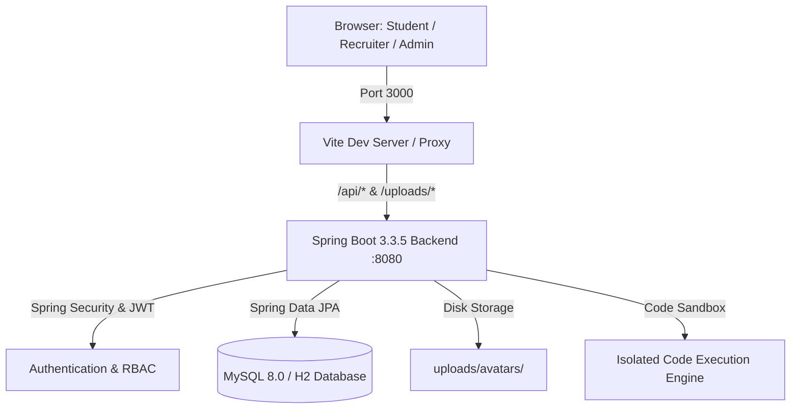

# 🚀 KASUMO — Truth-First Talent Intelligence Platform

> **Evidence-Driven Hiring & Candidate Verification System**
>
> Core Paradigm: `PROVABLE CODE` → `VERIFIED EVIDENCE` → `SKILL DNA` → `GAP INTELLIGENCE` → `OPPORTUNITIES` → `OUTREACH & MESSAGING` → `REAL OUTCOME`

[]()
[]()
[]()
[]()
[]()
[]()
[]()

---

## 📌 Executive Summary

**KASUMO** is a truth-first talent intelligence and recruitment platform designed to eliminate resume embellishment and arbitrary AI match percentages. It evaluates candidates strictly based on **demonstrable engineering proof**, verified credentials, live GitHub code artifacts, and sandbox-evaluated **DSA screening tests**.

---

## ✨ Point-to-Point Summary of Upgrades & Features

### 1. 🏢 Recruiter Portal (Upgraded UI/UX & Talent Intelligence)
- **Approved Reference Design**: Redesigned to match the enterprise recruitment reference with modern navigation, cards, and data visualization.
- **Clean Zero-State Foundation**: Zero fabricated statistics or dummy counts (`248`, `127`, `42`, `18`, `2,847` purged). All metrics cleanly load from real database records and default to `0` with clear empty states.
- **Complete Recruitment Navigation**:
  1. **Dashboard**: Live metrics (Candidates, Shortlisted, Applications, Hired), Top Recommended Candidates, Job Post Performance SVG curves, and Recent Activity.
  2. **Post Opportunity**: AI-powered Recruitment Agent Console with role parsing, skill extraction, screening configuration, and candidate matching (safe with 0 candidates).
  3. **Find Candidates**: Comprehensive talent discovery filtered by technology, graduation year, and verified credentials with direct shortlist and outreach actions.
  4. **Talent Search**: Semantic code artifact inspector querying repositories, architecture designs, and verified commits.
  5. **Shortlist**: Persistent candidate shortlist management.
  6. **Applications**: Multi-stage applicant tracking pipeline (`UNDER_REVIEW`, `SHORTLISTED`, `REJECTED`, `HIRED`).
  7. **Messages**: Direct messaging interface with student candidates for outreach and discussions.
  8. **Assessments**: Management of technical screening blueprints with question banks and evaluation criteria.
  9. **Analytics**: Real-time recruitment intelligence, candidate conversion metrics, and technology demand analytics.
  10. **My Organisation**: Enterprise profile, attestation status, and recruiter credentials.
  11. **Settings**: Profile photo management, name, notifications, and security configuration.
  12. **Help & Support**: Recruiter documentation, FAQs, and support center.

### 2. 🎓 Student Portal (Strictly Preserved Visual Design)
- **Zero Redesign / Strict Visual Integrity**: 100% preservation of original page backgrounds, card styles, fonts, layout, and warm color palette.
- **Recruiter Messages Feature (`/student/messages`)**:
  - Full dedicated messages page accessible via the student sidebar navigation and mobile bottom nav.
  - Review recruiter outreach notes, message back and forth with real timestamps, inspect recruiter organization details, and view connected opportunities.
  - Honest empty state when no recruiter messages exist.
- **Skill DNA & Radar Intelligence**: Dynamic polygon radar chart reflecting real uploaded and verified evidence across core competencies.
- **Evidence & Project Portfolio**: Upload GitHub repositories, deployed demos, certifications, and contest achievements with direct photo/screenshot attachments.
- **Student Settings & 2FA**: Manage student details, profile photo uploads, and Two-Factor Authentication (TOTP authenticator app integration).

### 3. 💻 DSA Screening Test Engine (Real Code Execution)
- **Candidate-Written Solutions**: Replaced predefined multiple-choice answers for programming questions with an actual code editor.
- **Multi-Language Sandbox**: Real code execution supporting **Java**, **Python**, **C++**, and **JavaScript**.
- **Deterministic Test Evaluation**:
  - Public sample test cases with expected input/output.
  - Hidden backend test cases protected from candidate inspection.
  - Compilation error, runtime error, time limit, and memory limit handling.
  - Automated grading and instant verified capability minting upon passing.

### 4. 🌓 Light and Dark Theme System
- Fully functioning light/dark theme toggle available in the header across both portals.
- Selected theme persists in `localStorage` across page navigation and reloads.
- No flashes of unstyled content (FOUC).
- Both portals independently respect their respective color palettes in both light and dark modes.

### 5. 📸 Profile Photo Upload & Localhost Serving
- **Photo Upload**: Supports JPG, JPEG, PNG, and WebP up to 5MB with file size and MIME-type validation.
- **Secure Persistence**: Stored under `uploads/avatars/` with database references in `users` and `students`.
- **Localhost Proxy Resolution**: Added `/uploads` proxy in Vite dev server (`http://localhost:3000/uploads` → `http://localhost:8080/uploads`) and `permitAll` in Spring Security, ensuring photos render seamlessly without 404 errors.

### 6. 🧹 100% Zero-Predefined Data (Clean Deployment Slate)
- **Purged Mock Records**: Removed seeded dummy students (*"Alex Rivera"*, *"Shaik Sohel"*), fake organizations (*"Acme Engineering"*), hardcoded opportunities (*"Java Backend Intern"*), and synthetic fallback opportunities (*TCS NQT*, *Microsoft*, *Google*).
- **Dynamic On-Demand Profiles**: Student profiles initialize cleanly on demand, preventing 403 errors while maintaining a zero-candidate recruiter view until students populate demonstrable proof.
- **400+ Taxonomy Skills**: Clean standard technology taxonomy and 5 structured evidence templates loaded from `data-local.sql`.

---

## 🏗️ Architecture & Technology Stack



| Layer | Technology | Details |
| :--- | :--- | :--- |
| **Frontend** | React 18, Vite 5.4, Tailwind CSS | Modular component architecture, Lucide icons |
| **Backend** | Spring Boot 3.3.5, Java 21 / 17 | REST API, Spring Security, JWT, JPA / Hibernate |
| **Database** | MySQL 8.0 (Prod) / H2 (Local/Test) | Flyway migrations, normalized relational schema |
| **Code Runner**| Isolated Process Execution | Multi-language compilation & sandbox test runner |
| **Storage** | Local Disk / Web MVC Handlers | Static resource handler for `/uploads/**` |
| **Testing** | Playwright E2E, JUnit 5, Mockito | End-to-end browser tests & integration suites |

---

## 📂 Project Structure

```
KASUMIO/
├── backend/
│   ├── src/main/java/com/kasumio/
│   │   ├── action/              # Career actions & outcome intelligence
│   │   ├── agent/               # Autonomous Recruiter Agent console & workflow
│   │   ├── assessment/          # DSA assessment engine, question banks, code evaluation
│   │   ├── auth/                # SecurityConfig, JWT tokens, AuthService, UserDto
│   │   ├── common/              # FileUploadController, SecurityUtils, OpenApiConfig
│   │   ├── config/              # WebMvcConfig (upload proxy), LocalDemoDataSeeder
│   │   ├── connection/          # Trusted recruiter-student connection requests & messaging
│   │   ├── discovery/           # Opportunity discovery & skill demand indexer
│   │   ├── evidence/            # Evidence submission, templates, institutional verification
│   │   ├── goal/                # Student career goals management
│   │   ├── opportunity/         # Opportunity creation, publishing, application tracking
│   │   ├── organization/        # Enterprise organization & attestation status
│   │   ├── student/             # Student profile, candidate search, calculated metrics
│   │   └── user/                # User entity, Role (STUDENT, RECRUITER, ADMIN)
│   ├── src/main/resources/
│   │   ├── application.yml      # Base Spring Boot config
│   │   ├── application-local.yml# In-memory local profile
│   │   └── data-local.sql       # 400+ skill taxonomy & 5 evidence templates
│   └── uploads/avatars/         # Stored profile photos
├── frontend/
│   ├── src/
│   │   ├── api/                 # Axios clients (auth, student, opportunity, assessment, etc.)
│   │   ├── components/
│   │   │   ├── common/          # Alert, Modal, ConfirmDialog, LoadingSpinner, EmptyState
│   │   │   ├── dashboard/       # Recruiter & Student dashboard widgets, metrics, radar
│   │   │   ├── layout/          # KasumoLayout, KasumoSidebar, KasumoHeader, KasumoMobileNav
│   │   │   └── recruiter/       # RecruiterAgentConsole, candidate cards, metrics
│   │   ├── context/             # AuthContext, ThemeContext
│   │   └── pages/
│   │       ├── recruiter/       # Upgraded recruiter pages (Candidates, Shortlist, Messages, Settings...)
│   │       ├── student/         # Preserved student pages (Discovery, Assessments, Intelligence, Messages...)
│   │       └── LoginPage.jsx    # Dual-portal authentication
│   ├── tests/
│   │   ├── zero_predefined_data.spec.ts        # 100% clean zero-data verification
│   │   ├── verification_portal_clean.spec.ts   # Profile photo, messaging & navigation
│   │   └── audit_fixes_comprehensive.spec.ts   # Recruiter workflow, 2FA & RBAC tests
│   ├── vite.config.js           # Proxies /api and /uploads to port 8080
│   └── vercel.json              # Vercel deployment configuration
├── render.yaml                  # Render Docker auto-deployment config
├── docker-compose.yml           # MySQL 8.0 local container
└── README.md                    # Platform documentation
```

---

## 🚀 Quick Start (Local Setup)

### Prerequisites
- **Java 17 or 21** (`java -version`)
- **Node.js 18+ & npm** (`node -v`)
- **Docker Compose** *(optional for local MySQL; H2 in-memory runs out of the box)*

---

### Step 1: Start Backend Server
```bash
cd backend
# Windows:
$env:JAVA_HOME="C:\Java\jdk-21.0.4+7"  # Adjust to your JDK path if needed
.\mvnw.cmd spring-boot:run

# Linux / macOS:
./mvnw spring-boot:run
```
Backend will start on `http://localhost:8080`. Health check: [http://localhost:8080/api/health](http://localhost:8080/api/health).

---

### Step 2: Start Frontend Dev Server
```bash
cd frontend
npm install
npm run dev
```
Open [http://localhost:3000](http://localhost:3000) in your browser.

---

### Step 3: Default Credentials

| Portal | Email | Password | Role |
| :--- | :--- | :--- | :--- |
| **Recruiter Portal** | `recruiter@kasumio.com` | `password123` | RECRUITER |
| **Student Portal** | `student@kasumio.com` | `password123` | STUDENT |
| **Admin Portal** | `admin@kasumio.com` | `password123` | ADMIN |

*(You can also use `/register` to create brand new accounts directly.)*

---

## 🧪 Testing & Verification

### Running Automated Playwright E2E Tests
```bash
cd frontend
npx playwright test
```

**Test Suite Coverage (9/9 Passing)**:
- `zero_predefined_data.spec.ts`: Verifies zero mock candidates, zero opportunities, zero blueprints, and 0 indexed technologies on a fresh system.
- `verification_portal_clean.spec.ts`: Verifies profile photo proxying (`HTTP 200`), student messages navigation, and clean empty states.
- `audit_fixes_comprehensive.spec.ts`: Verifies recruiter navigation, 0-candidate opportunity publishing, mobile navigation, and student 2FA settings.

### Running Backend Unit & Integration Tests
```bash
cd backend
./mvnw test
```

---

## 🌐 Production Deployment

- **Frontend (Vercel)**: Automatically deploys on git push via [vercel.json](file:///c:/Users/Lenovo/Downloads/startups/KASUMIO/vercel.json) to `https://kasumio.vercel.app`.
- **Backend (Render)**: Automatically builds and deploys the containerized Spring Boot backend via [render.yaml](file:///c:/Users/Lenovo/Downloads/startups/KASUMIO/render.yaml) using [Dockerfile](file:///c:/Users/Lenovo/Downloads/startups/KASUMIO/backend/Dockerfile).

---

## 📄 License & Attribution

Copyright © 2026 KASUMO Platform. All rights reserved.
Developed for truthful, unforgeable, evidence-backed talent intelligence.
