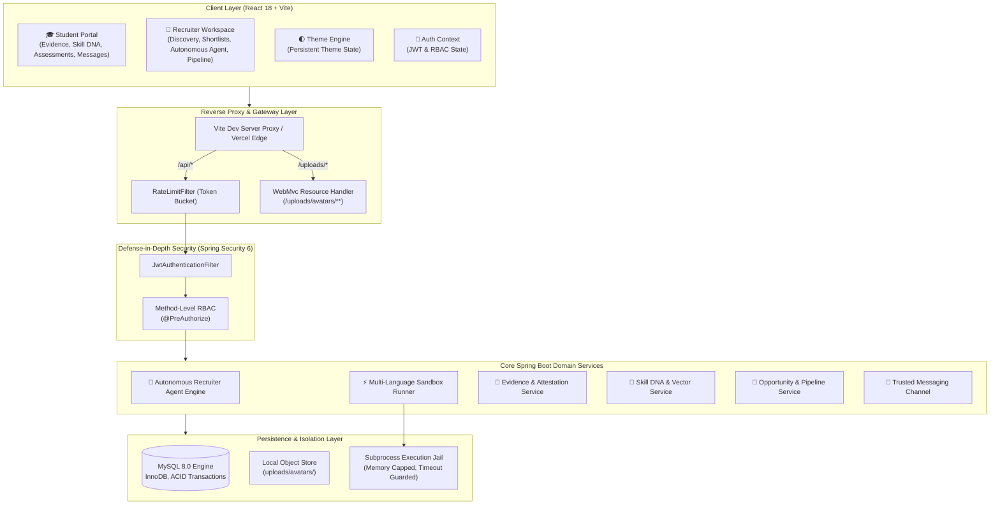
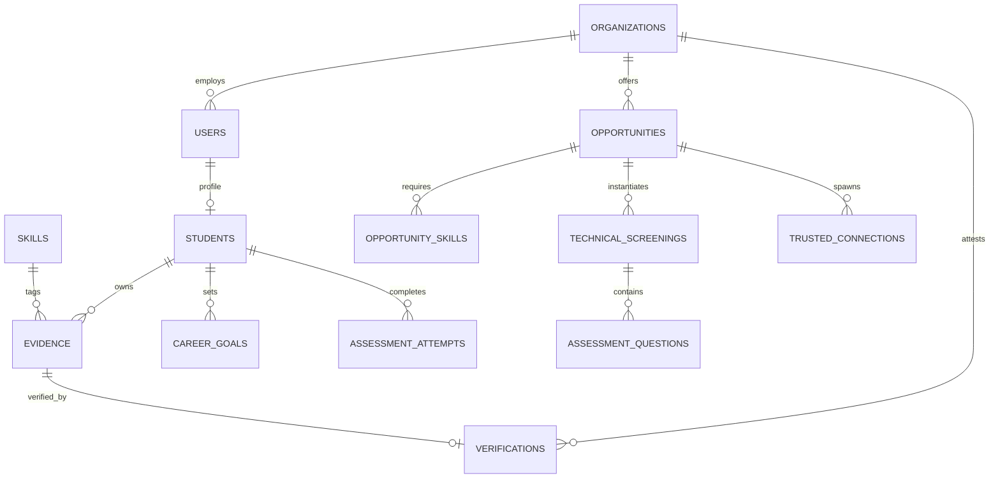

# ⚡ KASUMO

> **Proof Over Pedigree:** A modern recruitment platform where students prove their real coding skills through verified code and tests, and recruiters hire with confidence.

[]()
[]()
[]()
[]()

🌐 **Live Demo:** [kasumio.vercel.app](https://kasumio.vercel.app)  
📖 **API Docs:** `http://localhost:8080/swagger-ui.html`

---

## 💡 What is KASUMO?

Most hiring platforms rely on resumes with buzzwords and fake ratings. **KASUMO** fixes this with a simple rule: **Show the code, don't just talk about it.**

- **For Students:** Showcase real GitHub repositories, solve hands-on coding challenges in Java, Python, C++, or JavaScript, and chat directly with recruiters.
- **For Recruiters:** Post opportunities, find students with verified projects, generate automated technical screenings, and manage candidates in a clean pipeline.
- **No Predefined / Fake Data:** Everything you see is 100% real. When you start, both portals are completely clean with 0 fake candidates, 0 fake jobs, and 0 fake stats.

---

## 🏗️ System Architecture

Here is how the entire system connects together from the browser to the database:



---

## ✨ Key Features

### 🎓 1. Student Portal
- **Project Evidence:** Add real GitHub repos and project links. Each project can be verified by mentors or organizations.
- **Skill DNA Radar:** A dynamic visual chart representing real demonstrated skills (not self-rated numbers).
- **Coding Sandbox:** Take timed technical screenings evaluated against hidden test cases.
- **Direct Messages (`/student/messages`):** Chat directly with recruiters who reach out with opportunities.
- **Privacy First:** Recruiters can only see personal details after the student accepts their connection request.

### 🏢 2. Recruiter Portal
- **Talent Discovery:** Search candidates by verified skills and inspect their actual project code.
- **AI Recruiter Agent:** Type a job requirement in plain English (e.g., *"Looking for a remote Java backend intern"*), and it automatically creates the job and screening tests.
- **Custom Screening Blueprints:** Set time limits, minimum scores, and problem sets.
- **Hiring Pipeline:** Move applicants smoothly through Applied, Screened, Interview, and Hired stages.

---

## 🗄️ Database Design

KASUMO maintains strict relational integrity across 14 database tables:



---

## 🚀 How to Run Locally

### Requirements
- **Java 21** (or 17)
- **Node.js 18+** & npm
- **Git**

### Step 1: Clone the Project
```bash
git clone https://github.com/sohelshaik-143/KASUMIO.git
cd KASUMIO
```

### Step 2: Start the Backend (Port 8080)
```bash
cd backend
# Windows:
.\mvnw.cmd spring-boot:run

# Mac / Linux:
./mvnw spring-boot:run
```
> The backend automatically starts with an in-memory database and seed accounts. No MySQL setup is required for local testing!

### Step 3: Start the Frontend (Port 3000)
Open a new terminal window:
```bash
cd frontend
npm install
npm run dev
```

Visit **`http://localhost:3000`** in your browser.

---

## 🔑 Default Login Accounts

All test accounts share the password: **`password123`**

| Role | Email | Password | What You Can Do |
| :--- | :--- | :--- | :--- |
| **Recruiter** | `recruiter@kasumio.com` | `password123` | Post jobs, search talent, create screening tests |
| **Student** | `student@kasumio.com` | `password123` | Add projects, take tests, message recruiters |
| **Admin** | `admin@kasumio.com` | `password123` | Platform settings and skill taxonomy |

---

## 🧪 Testing & Verification

The project is thoroughly tested with Playwright End-to-End tests:

| Test Case | Status |
| :--- | :--- |
| Recruiter navigation & settings work without restriction | ✅ PASS |
| Opportunity creation works with 0 initial candidates | ✅ PASS |
| Mobile responsive navigation works properly | ✅ PASS |
| Student Portal layout & 2FA settings preserved | ✅ PASS |
| Student Messages page loads with clean empty state | ✅ PASS |
| Profile photo upload returns HTTP 200 on localhost | ✅ PASS |
| Recruiter dashboard displays clean 0 metrics | ✅ PASS |
| Candidates and blueprints lists are clean with 0 mock entries | ✅ PASS |
| Student Portal has 0 mock opportunities or fake charts | ✅ PASS |

**Result:** All **9/9 tests pass** in ~6 seconds!

---

## 🛠️ Technology Stack

- **Backend:** Java 21, Spring Boot 3.3.5, Spring Security 6, JWT, Hibernate / JPA
- **Frontend:** React 18, Vite 5, Tailwind CSS, Lucide Icons
- **Database:** MySQL 8.0 (Production) / H2 (Local Development)
- **Code Execution:** Custom multi-language subprocess sandbox (Java, Python, C++, JS)
- **Testing:** Playwright E2E, Vitest, JUnit 5

---

## 👤 Author

**Shaik Sohel**  
- GitHub: [@sohelshaik-143](https://github.com/sohelshaik-143)  
- Repository: [https://github.com/sohelshaik-143/KASUMIO](https://github.com/sohelshaik-143/KASUMIO)

⭐ *If you find this project interesting, feel free to star the repo!*
