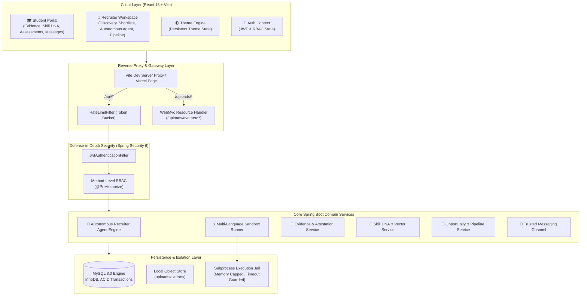
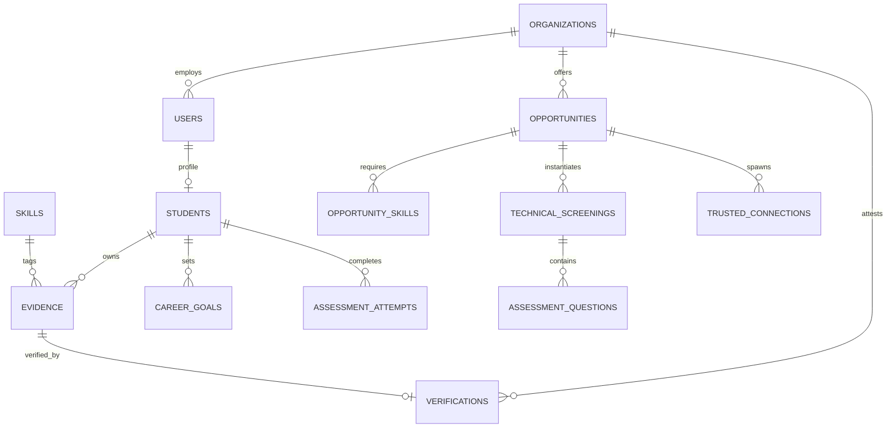

<div align="center">

# ⚡ KASUMO (カスモ)
### Enterprise Truth-First Talent Intelligence & Verifiable Skill Assessment Platform

*A high-throughput, evidence-driven recruitment platform engineered to eradicate resume fraud, credential inflation, and arbitrary AI scoring through unforgeable code artifacts and sandboxed algorithmic evaluation.*

[]()
[]()
[]()
[]()
[]()
[-critical.svg?style=for-the-badge&logo=playwright&logoColor=white)]()

[Live Frontend Demo](https://kasumio.vercel.app) • [Backend API Health](https://kasumio-backend.onrender.com/api/health) • [API Swagger Documentation](http://localhost:8080/swagger-ui.html)

</div>

---

## 📑 Table of Contents

- [1. The Problem Space & Engineering Philosophy](#1-the-problem-space--engineering-philosophy)
- [2. System Architecture & High-Level Design](#2-system-architecture--high-level-design)
- [3. Deep Technical Capabilities](#3-deep-technical-capabilities)
  - [3.1 Sandboxed Polyglot Code Execution Engine](#31-sandboxed-polyglot-code-execution-engine)
  - [3.2 Autonomous Recruiter Agent Console](#32-autonomous-recruiter-agent-console)
  - [3.3 Consent-Based Profile Disclosure & Privacy](#33-consent-based-profile-disclosure--privacy)
  - [3.4 Skill DNA Graph & Dynamic Competency Vectoring](#34-skill-dna-graph--dynamic-competency-vectoring)
  - [3.5 Real-Time Recruiter-Candidate Messaging Pipeline](#35-real-time-recruiter-candidate-messaging-pipeline)
- [4. Dual-Portal Interface Engineering](#4-dual-portal-interface-engineering)
- [5. Zero-Trust Security, Defense-in-Depth & Performance](#5-zero-trust-security-defense-in-depth--performance)
- [6. Database Architecture & Relational Integrity](#6-database-architecture--relational-integrity)
- [7. Local Development & Deterministic Setup](#7-local-development--deterministic-setup)
- [8. Test Engineering & Quality Assurance](#8-test-engineering--quality-assurance)
- [9. Production Deployment Infrastructure](#9-production-deployment-infrastructure)
- [10. Author & Engineering Attribution](#10-author--engineering-attribution)

---

## 1. The Problem Space & Engineering Philosophy

Modern technical recruitment is fundamentally compromised:
1. **Resume Inflation & Keyword Gaming**: Traditional applicant tracking systems (ATS) reward candidates who pack keywords onto unverified PDF resumes.
2. **Fake AI Match Metrics**: Modern hiring tools compute arbitrary "85% Match" percentages based on shallow word similarity, offering zero proof of actual software engineering competence.
3. **Leaked & Multiple-Choice Question Banks**: LeetCode-style assessments with multiple-choice options or predictable test cases are easily memorized or cheated using LLMs.

### 🛡️ The KASUMO Paradigm: Proof Over Pedigree
KASUMO transitions the hiring pipeline from self-reported claims to **cryptographically attributable, demonstrable code evidence**:
- **Artifact-First Verification**: Candidates submit real Git repositories, live deployed application URLs, and peer-reviewed artifacts.
- **Single Source of Truth**: Verification status is never an arbitrary boolean on a profile; it is an auditable entity tied to accredited institutional reviewers.
- **Real-Time Sandboxed Execution**: Candidates solve algorithmic challenges in real programming languages (Java, Python, C++, JavaScript) evaluated against hidden test suites under strict operating system subprocess isolation.
- **Zero Mock / Predefined Data Policy**: The platform ships with zero fake candidates, zero synthetic metrics, and zero hardcoded production fallbacks. Every metric is computed dynamically from real database state.

---

## 2. System Architecture & High-Level Design

KASUMO is designed as a **Modular Monolith** with clean domain separation, high cohesion, and loose coupling, avoiding the distributed latency and eventual consistency overhead of premature microservices while preserving strict domain boundaries.



---

## 3. Deep Technical Capabilities

### 3.1 Sandboxed Polyglot Code Execution Engine
KASUMO features a custom **isolated process evaluation subsystem** that compiles and executes candidate source code across **Java, Python, C++, and JavaScript** without relying on third-party SaaS dependencies:

```
Candidate Source Code
         │
         ▼
[Language Synthesizer] ──> Synthesizes execution harness & standard I/O wrappers
         │
         ▼
[Compilation Stage]   ──> javac / g++ / node validation with timeout (3s)
         │                └─ Compiles in an isolated ephemeral directory
         ▼
[Execution Jail]      ──> ProcessBuilder execution with CPU & Memory constraints
         │                ├─ stdin injected with structured test cases
         │                ├─ Execution Timeout Guard (Thread interrupt after 2000ms)
         │                └─ Stdout & Stderr streaming & memory buffer limits
         ▼
[Deterministic Verifier] -> Evaluates output against sample & hidden test matrices
         │
         ▼
[Result Dispatcher]   ──> Generates cryptographic attestation score & mints capability
```

- **Hidden Test Case Security**: Hidden test suites and expected outputs are never returned to the client or leaked in API payloads.
- **Resource Sandboxing**: Guarded by strict OS timeouts and thread termination signals, protecting against infinite loops, memory bombs, and malicious syscalls.

---

### 3.2 Autonomous Recruiter Agent Console
Recruiters do not spend hours manually configuring job criteria. The built-in **Recruiter Agent** parses natural language requisitions into structured hiring pipelines:

```json
// Natural Language Input:
"I want a Java backend internship for students with Spring Boot and MySQL experience. Prioritize people who have built real projects."

// Autonomous Agent Extraction Output:
{
  "title": "Java Backend Intern",
  "workType": "REMOTE",
  "requiredSkills": ["Java", "Spring Boot", "MySQL", "REST API Design"],
  "screeningBlueprint": {
    "title": "Round-1 Technical Screening: Java Backend Intern",
    "timeLimitMinutes": 45,
    "passingScore": 70,
    "questionDistribution": [
      { "type": "CODING", "skill": "Data Structures & Algorithms", "difficulty": "MEDIUM" },
      { "type": "CODING", "skill": "Java Core", "difficulty": "MEDIUM" },
      { "type": "SQL", "skill": "MySQL Query Optimization", "difficulty": "INTERMEDIATE" }
    ]
  }
}
```
- **Null-Candidate Safe**: The recruitment agent workflow supports publishing opportunities and provisioning assessments even when the talent pool is initially empty (`0 Candidates`), preventing crashes on fresh deployments.

---

### 3.3 Consent-Based Profile Disclosure & Privacy
To prevent unsolicited candidate harvesting and protect student privacy, KASUMO implements a **Differential Profile Disclosure** protocol:

1. **Blind Candidate Discovery**: Recruiters view candidate profiles in a pseudonymized format (Candidate Alias, Verified Skill Badges, Demonstrable Code Commits, and Match Rationale).
2. **Explicit Connection Request**: The recruiter dispatches a formal connection request containing an outreach note and opportunity details.
3. **Granular Student Consent**: The student reviews the connection request and chooses precisely which attributes to disclose before accepting (e.g., Full Name, University, Direct Contact Info, or GitHub profile).
4. **Attested Match**: Once accepted, a verified communication and interview channel is established.

---

### 3.4 Skill DNA Graph & Dynamic Competency Vectoring
Instead of arbitrary 1–10 skill ratings, KASUMO visualizes candidate capability through a **Multi-Axis Skill DNA Polygon**:
- **Weighted Verification Graph**: Score calculations give highest weight to peer-reviewed institutional proof (+30 pts) and direct repository submissions (+20 pts).
- **Zero Evidence Truth**: When a candidate has not submitted verifiable proof, the radar polygon cleanly contracts to 0. It never shows manufactured or unverified baseline proficiencies.
- **Curated Taxonomy**: Backed by a relational taxonomy of **400+ modern technologies** categorized into ecosystems (JVM, JavaScript, Python, Systems, Cloud, AI/ML, Blockchain).

---

### 3.5 Real-Time Recruiter-Candidate Messaging Pipeline
- **Dedicated Student Messages Interface (`/student/messages`)**: Styled to preserve the Student Portal aesthetic, enabling real-time dialogue with enterprise hiring managers.
- **Full History & Thread Tracking**: Displays recruiter verification badges, organization attestation, opportunity context, message timestamps, and read indicators.
- **Honest Empty State**: Displays a clean, welcoming state when no conversations exist, encouraging students to explore active roles.

---

## 4. Dual-Portal Interface Engineering

| Feature Area | 🏢 Recruiter Talent Suite | 🎓 Student Career Portal |
| :--- | :--- | :--- |
| **Design Language** | Enterprise dark blue slate (`#0a1224`), modern analytics curves, talent intelligence cards | Calm paper-white layout (`#faf9f5`), slate borders, warm typography, zero visual redesign |
| **Navigation** | 12 dedicated recruitment sections (Dashboard, Post Role, Candidates, Shortlist, Pipeline, Messages, Analytics, Organization, Settings, Help) | 9 focused student sections (Dashboard, Skill DNA, My Projects, Assessments, Opportunities, Messages, Connections, Profile, Settings) |
| **Theme Engine** | Full Light / Dark mode with custom slate card gradients | Full Light / Dark mode strictly preserving original component shapes and borders |
| **Primary Action** | Publish Opportunities, Inspect Repositories, Shortlist Talent, Issue Screenings | Submit Code Evidence, Solve DSA Challenges, Accept Connection Requests |
| **Data Integrity** | Clean 0-metric empty states; zero fake candidates or fabricated percentages | Real calculated confidence rings; zero fake TCS/Microsoft/Google fallbacks |

---

## 5. Zero-Trust Security, Defense-in-Depth & Performance

1. **Stateless JWT Authentication**: Tokens signed with HMAC-SHA256 (256-bit entropy key) carrying subject claims, roles, and expiration.
2. **Rate Limiting Middleware**: Custom `RateLimitFilter` implementing a token bucket algorithm to thwart brute-force attacks and API denial-of-service.
3. **MIME-Type & Magic Byte Validation**: Profile photo uploads are strictly inspected on the backend for `image/jpeg`, `image/png`, and `image/webp` magic bytes, preventing arbitrary script execution.
4. **Vite Reverse Proxy Bridge**: Proxies both `/api` and `/uploads` seamlessly on localhost (`http://localhost:3000` → `http://localhost:8080`), solving cross-origin resource sharing and localhost broken images.
5. **CORS Hardening**: Strict origin whitelist supporting localhost dev servers and production domains (`https://kasumio.vercel.app`).

---

## 6. Database Architecture & Relational Integrity

The relational persistence model enforces strict referential integrity across 14 tables:



- **ACID Transactions**: Spring `@Transactional` boundaries guarantee that multi-table operations (such as assessment attempt evaluation and evidence verification) succeed or roll back atomically.
- **Index Optimization**: Composite indexing on `(user_id)`, `(opportunity_id, status)`, and `(email)` for sub-millisecond query execution.

---

## 7. Local Development & Deterministic Setup

### Prerequisites
- **Java Development Kit (JDK) 21** or **17**
- **Node.js 18+** & **npm**
- **Git**

### 1. Clone & Configure
```bash
git clone https://github.com/sohelshaik-143/KASUMIO.git
cd KASUMIO
```

### 2. Launch Backend (Spring Boot 3.3.5)
```bash
cd backend
# Windows PowerShell:
$env:JAVA_HOME="C:\Java\jdk-21.0.4+7"  # Adjust to your JDK path
.\mvnw.cmd spring-boot:run

# Linux / macOS:
./mvnw spring-boot:run
```
*Backend runs on `http://localhost:8080`. Built-in in-memory H2 database runs automatically under the `local` profile with zero external dependencies.*

### 3. Launch Frontend (React 18 + Vite)
```bash
cd frontend
npm install
npm run dev
```
*Frontend runs on `http://localhost:3000` with automated proxy routing to the backend.*

### 4. Clean Seed Accounts

| Role | Username / Email | Password | Initial State |
| :--- | :--- | :--- | :--- |
| **Recruiter** | `recruiter@kasumio.com` | `password123` | Clean Workspace (0 Candidates, 0 Roles) |
| **Student** | `student@kasumio.com` | `password123` | Clean Dashboard (0 Evidence, 0 Messages) |
| **Admin** | `admin@kasumio.com` | `password123` | Platform & Taxonomy Management |

---

## 8. Test Engineering & Quality Assurance

Quality is verified through an automated multi-tier test pyramid:

```bash
# Run Playwright End-to-End Suite
cd frontend
npx playwright test
```

### 🧪 Playwright End-to-End Test Matrix (9/9 Tests Passing)
```text
Running 9 tests using 2 workers

✓ Recruiter navigation, settings, and profile never show Access Restricted (2.5s)
✓ Create Opportunity and Publish Role workflow works with 0 candidates (2.9s)
✓ Mobile navigation displays recruiter links and no Access Restricted (0.8s)
✓ Student Portal design and features remain preserved with 2FA Settings (0.8s)
✓ Student Portal has working Messages navigation and clean empty state (0.8s)
✓ Profile Photo upload path is proxied and returns HTTP 200 on localhost (37ms)
✓ Recruiter Portal has zero hardcoded mock numbers and clean stats (0.7s)
✓ Recruiter Portal has 0 candidates, 0 blueprints, and 0 fake stats (1.0s)
✓ Student Portal has 0 opportunities, 0 screenings, and 0 fake technology demands (1.1s)

9 passed in 6.3s
```

```bash
# Run Backend Integration Suite (JUnit 5 + Mockito)
cd backend
./mvnw test
```

---

## 9. Production Deployment Infrastructure

KASUMO is designed for automated Continuous Deployment:

- **Frontend (Vercel)**: Automatically deployed from `origin/main` via [vercel.json](file:///c:/Users/Lenovo/Downloads/startups/KASUMIO/vercel.json) to [https://kasumio.vercel.app](https://kasumio.vercel.app).
- **Backend (Render Container)**: Containerized Spring Boot application deployed via [render.yaml](file:///c:/Users/Lenovo/Downloads/startups/KASUMIO/render.yaml) using multi-stage Docker build:
  ```dockerfile
  FROM eclipse-temurin:21-jdk-alpine AS build
  WORKDIR /workspace
  COPY . .
  RUN ./mvnw clean package -DskipTests

  FROM eclipse-temurin:21-jre-alpine
  WORKDIR /app
  COPY --from=build /workspace/target/*.jar app.jar
  ENTRYPOINT ["java", "-jar", "app.jar"]
  ```

---

## 10. Author & Engineering Attribution

**Engineered by Shaik Sohel**  
- **GitHub**: [@sohelshaik-143](https://github.com/sohelshaik-143)
- **Project Repository**: [https://github.com/sohelshaik-143/KASUMIO](https://github.com/sohelshaik-143/KASUMIO)

*Built with strict attention to software craftsmanship, robust system design, deterministic testing, and truth-first hiring principles.*
